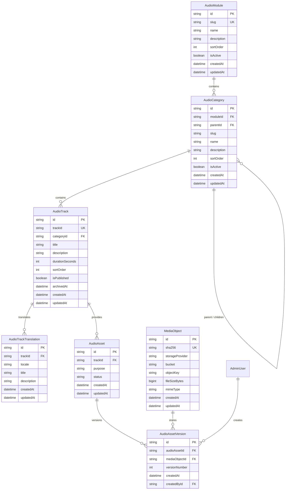

# Sheikh Zabuur Audio Library — Production Database Architecture

**Document Version:** 1.0.0  
**Target Engine:** PostgreSQL 14+ (Hosted on Neon Serverless)  
**ORM:** Prisma ORM 6.x  
**Authority:** Master Audio Architecture for `nasiramme1511/Sheikh_Zabuur_Admin`

---

## 1. Entity-Relationship Diagram (ERD)

---

## 2. Table Responsibilities & Architecture

### A. `AudioModule`
- **Responsibility:** Represents the top-level educational curriculum (e.g., *Beyquna*, *Usul*, *Tafseer*, *Bulugh*).
- **Primary Business Key:** `slug` (unique, lowercase, URL-safe string).
- **Normalization Rule:** Module titles and descriptions are defined once. They are never repeated across categories or audio tracks.

### B. `AudioCategory`
- **Responsibility:** Represents hierarchical category groupings within a module.
- **Hierarchical Nesting:** Self-referencing via `parentId`. Unlimited nesting depth supported.
- **Constraints:**
  - `@@unique([moduleId, slug])`: Enforces that no two categories in the same module share a slug.
  - Foreign key constraints ensure child categories reference only parent categories within the same module.

### C. `AudioTrack`
- **Responsibility:** Canonical metadata record for an individual audio lecture.
- **Immutable Identifier:** `trackId` (e.g., `beyquna-001`, `usul-kitabul-tohid-001`). Matches mobile SQLite persistence (`downloads`, `favorites`, `playback_progress`) exactly.
- **Category Association:** Belongs directly to `AudioCategory`. Module association is derived via `category.moduleId` rather than redundantly stored.
- **Ordering Constraint:** `@@unique([categoryId, sortOrder])`: Enforces unique sequential ordering of tracks within each category.
- **Archival:** Uses `archivedAt` timestamp for soft-deletion. Published tracks with historical mobile installations are never hard-deleted.

### D. `AudioTrackTranslation`
- **Responsibility:** Normalized multilingual representations of track titles and descriptions.
- **Supported Locales:** `am` (Amharic), `ar` (Arabic), `en` (English).
- **Constraint:** `@@unique([trackId, locale])`: Exactly one localized record per track per language. Eliminates repeated language-specific columns in `AudioTrack`.

### E. `AudioAsset`
- **Responsibility:** Logical audio asset associated with a track.
- **Asset Purpose:** Represents the rendition purpose (e.g., `streaming`, `original`, `master`, `hls`).
- **Constraint:** `@@unique([trackId, purpose])`: Prevents duplicate logical asset definitions for the same track.

### F. `MediaObject`
- **Responsibility:** Physical file storage metadata.
- **Integrity & Deduplication:** Primary deduplication is enforced via `sha256 @unique`. If the same physical MP3 file is uploaded twice, the physical storage object is reused rather than duplicated.
- **Storage Independence:** Vendor-independent `storageProvider` field supports `archive_org`, `cloudflare_r2`, `aws_s3`, and `local_storage`.
- **Location Constraint:** `@@unique([storageProvider, bucket, objectKey])`.
- **Safe BigInt:** `fileSizeBytes` is stored as PostgreSQL `BIGINT` and serialized safely using `serializeBigInt()`.

### G. `AudioAssetVersion`
- **Responsibility:** Immutable version history of logical audio assets.
- **Constraint:** `@@unique([audioAssetId, versionNumber])`.
- **Auditability:** Links to `AdminUser.id` via `createdById` to track who uploaded each version.

---

## 3. Deduplication Strategy

1. **Physical File Deduplication:**
   - Client and server compute the SHA-256 hash of audio files.
   - `MediaObject.sha256` ensures identical audio bytes are stored only once in cloud storage.
2. **Logical Entity Deduplication:**
   - Modules: `AudioModule.slug`
   - Categories: `AudioCategory.[moduleId, slug]`
   - Tracks: `AudioTrack.trackId` and `AudioTrack.[categoryId, sortOrder]`
   - Translations: `AudioTrackTranslation.[trackId, locale]`
   - Assets: `AudioAsset.[trackId, purpose]`
   - Versions: `AudioAssetVersion.[audioAssetId, versionNumber]`
3. **Database-Level Protection:**
   - Unique constraints prevent race conditions and concurrent double-uploads at the relational database engine level.

---

## 4. Deletion & Archival Strategy

1. **Published Tracks:**
   - Tracks that have been published in a mobile catalog release (`isPublished = true`) cannot be hard-deleted.
   - Deactivation sets `archivedAt = NOW()` and `isPublished = false`.
   - The catalog compiler excludes archived tracks from future catalog releases while preserving existing mobile downloads.
2. **Draft Test Tracks:**
   - Unreleased tracks created during upload testing (`isPublished = false`, no catalog release references) can be soft-archived or purged upon administrative approval.
3. **Categories:**
   - Categories with active tracks or child subcategories cannot be deleted (`onDelete: Restrict`).
   - Tracks must be explicitly reassigned before a category can be retired.

---

## 5. Mobile Catalog Compatibility Contract

The normalized relational database is the administrative **source of truth**. The mobile application consumes a compiled publication artifact (`catalog.json` and `catalogVersion.json`):

1. **Compilation Query:**
   `AudioTrack` joins `category.module`, `translations`, and `assets.versions.mediaObject` to produce the exact JSON format required by the mobile app.
2. **Deterministic Identifiers:**
   `trackId` (e.g., `beyquna-001`) is preserved with zero changes.
3. **Storage URLs:**
   Compiled dynamically from `storageProvider`, `bucket`, and `objectKey`, ensuring temporary signed URLs are never baked into permanent database rows.

---

## 6. Verification Status

| Check | Tool | Result |
|---|---|---|
| Prisma Schema Format | `npx prisma format` | Passed |
| Prisma Schema Validation | `npx prisma validate` | Passed |
| Prisma Client Generation | `npx prisma generate` | Passed (v6.19.3) |
| Live Neon PostgreSQL Push | `npx prisma db push` | Synced (Zero data loss) |
| TypeScript Strict Check | `npm run typecheck` | Passed (0 errors) |
| ESLint Analysis | `npm run lint` | Passed (0 warnings) |
| Production Build | `npm run build` | Passed (18/18 routes) |

