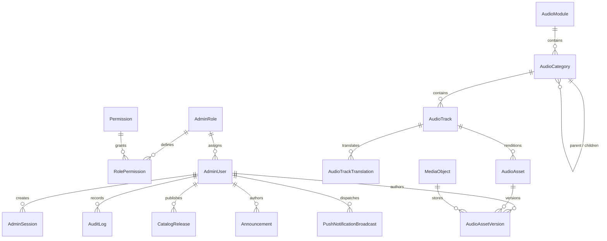

# Sheikh Zabuur Admin Platform — Master Database Architecture

**Document Version:** 2.0.0  
**Target Engine:** PostgreSQL 14+ (Hosted on Neon Serverless Postgres)  
**ORM:** Prisma ORM 6.x with strict TypeScript types  
**Audio Architecture Reference:** See [AUDIO_LIBRARY_DATABASE_DESIGN.md](AUDIO_LIBRARY_DATABASE_DESIGN.md)

---

## 1. Relational Topology & Entity Overview

---

## 2. Model Directory & Canonical Responsibilities

| Model | Table | Responsibility |
|---|---|---|
| `AdminRole` | `admin_roles` | Core RBAC roles (`SUPER_ADMIN`, `CONTENT_MANAGER`, `EDITOR`, `VIEWER`) |
| `Permission` | `permissions` | Granular permission keys (`tracks:write`, `releases:publish`, etc.) |
| `RolePermission` | `role_permissions` | Junction table mapping permissions to roles |
| `AdminUser` | `admin_users` | Administrator accounts secured with Argon2id |
| `AdminSession` | `admin_sessions` | Cryptographic SHA-256 session token hashes |
| `AuditLog` | `audit_logs` | Immutable audit trail with actor, action, IP, and JSON changesets |
| `SystemSetting` | `system_settings` | Central platform feature flags and client constraints |
| `AudioModule` | `audio_modules` | Top-level curriculum modules (e.g., *Beyquna*, *Usul*) |
| `AudioCategory` | `audio_categories` | Hierarchical category taxonomy with unlimited nesting |
| `AudioTrack` | `audio_tracks` | Canonical audio track metadata with immutable `trackId` |
| `AudioTrackTranslation` | `audio_track_translations` | Normalized multilingual titles (`am`, `ar`, `en`) |
| `AudioAsset` | `audio_assets` | Logical audio renditions (`streaming`, `original`, `master`) |
| `MediaObject` | `media_objects` | Physical storage objects deduplicated by `sha256` |
| `AudioAssetVersion` | `audio_asset_versions` | Immutable version audit linking assets to media objects |
| `CatalogRelease` | `catalog_releases` | Published mobile catalog snapshots with MD5/SHA256 checksums |
| `Announcement` | `announcements` | In-app notification banners for mobile users |
| `PushDeviceToken` | `push_device_tokens` | Registered Expo Push device tokens |
| `PushNotificationBroadcast` | `push_notification_broadcasts` | Broadcast delivery metrics and status |

---

## 3. Detailed Specifications

For in-depth relational specifications, unique constraints, indexing strategies, deduplication architecture, and mobile synchronization contracts, refer directly to:
* **[Audio Library Database Design](AUDIO_LIBRARY_DATABASE_DESIGN.md)**
* **[Global Deduplication Audit](GLOBAL_DEDUPLICATION_AUDIT.md)**
* **[Production Operations Manual](PRODUCTION_OPERATIONS_MANUAL.md)**

